

# OSIRIS

**A self-hosted personal workspace: media, games, server monitoring and home devices in one interface.**

*Organization, Supervision & Integration of Resources, Information & Services*

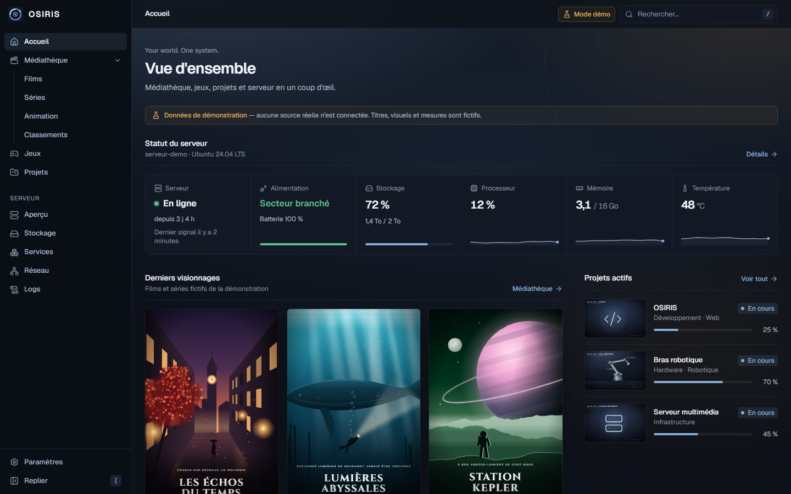

Home page: server health, recently watched titles and active projects. All screenshots use <b>demo mode</b> or an <b>isolated local instance with fictitious data</b>. The interface is in French.

---

## What is OSIRIS?

OSIRIS is a web application I run on my own Linux server. It replaces a handful of separate tools with one coherent interface:

- 🎬 **a personal media catalog** that stays independent of the files on disk, kept in sync with Jellyfin;
- 🎮 **a games library** synchronized with Steam and enriched by IGDB;
- 🖥️ **live monitoring** of the server, its services and its storage;
- 📡 **my devices**: inventory, remote power-on of my PC, file transfers between phone and computer.

It has been **in production since October 2026**, reachable only through my private Tailscale network, on desktop and as an iPhone home-screen app.

> **This repository is a documentation showcase.** The main source code stays in a private repository: no code, configuration, credentials or personal data are published here.

## Features

### Media library

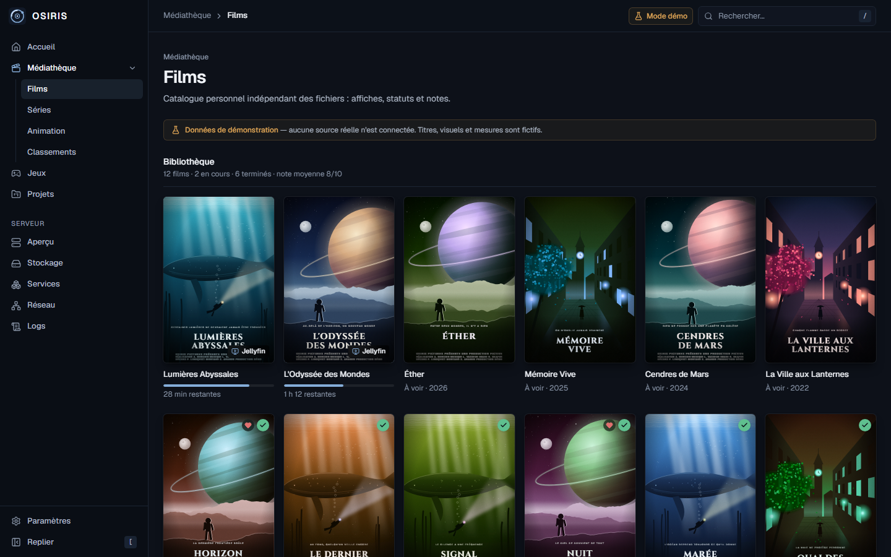

- **Films, series and animation** libraries with search, filters, sorting and server-side pagination; detail pages with TMDB metadata, status, half-point rating, favorite, notes and cast.
- Scheduled read-only **Jellyfin** sync that updates progress and "recently watched" **without ever overwriting** a rating, note or manual choice.
- **Top 10** rankings for films, series, animation and games, reordered with the mouse, keyboard or touch. [Detail page and Top 10 →](docs/gallery.md#media-library)

### Games

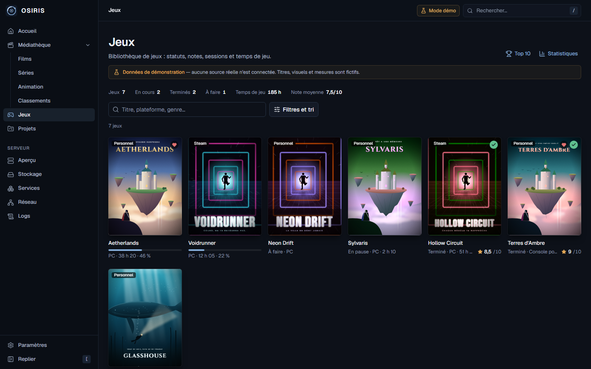

- **Steam library and personal games** side by side, labelled by origin and filtered on the server; game pages with playtime, sessions, progress, rating, review and achievements.
- Scheduled read-only **Steam** sync and **IGDB** metadata; games are added through IGDB search only.
- Statistics, Top 10 Games, and a compact command bar with a bottom sheet on mobile. [Game page and statistics →](docs/gallery.md#games)

### Server monitoring

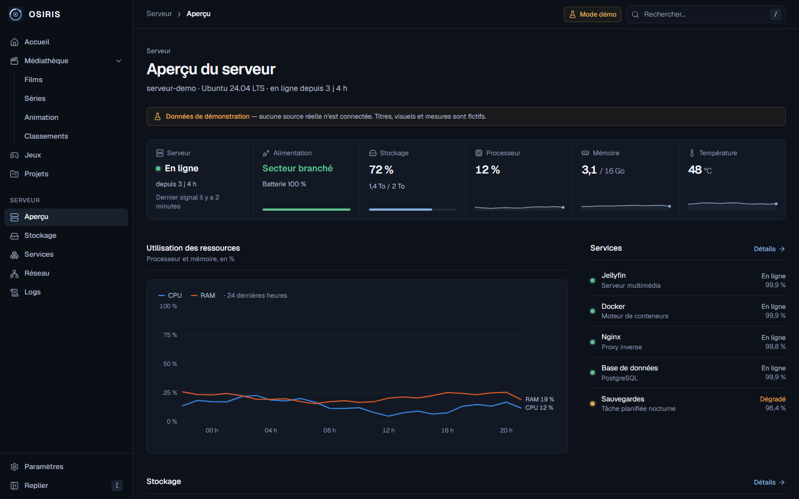

CPU, memory, temperature, power and disks <b>updated every second</b> by a separate host agent; services status; daily storage analysis and an on-demand duplicate scan (SHA-256), <b>strictly read-only</b>. <a href="docs/gallery.md#server">Storage analysis →</a>

### Devices and Wake-on-LAN

<table>
<tr>
<td width="50%">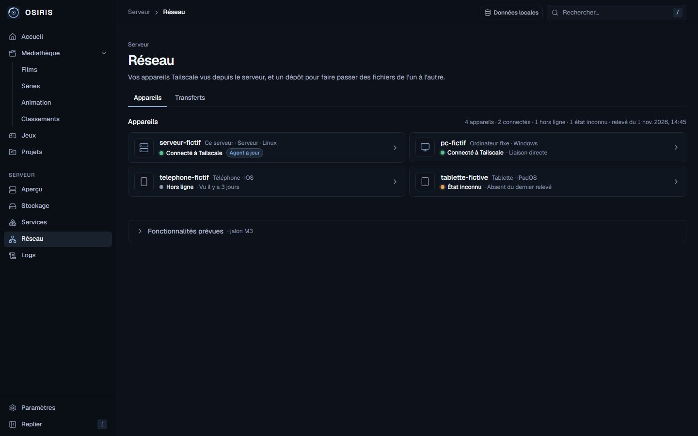</td>
<td width="50%">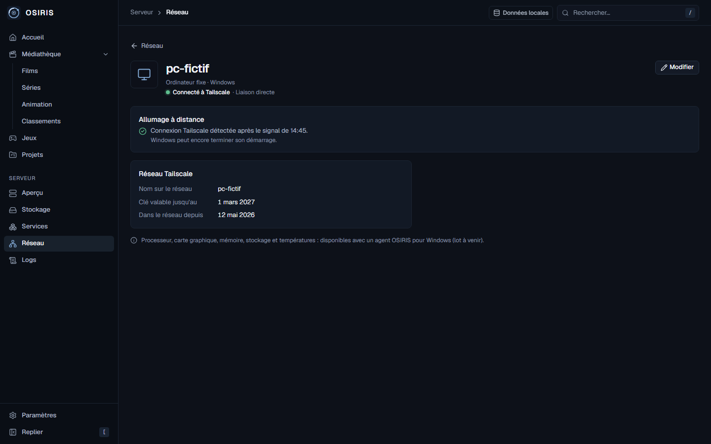</td>
</tr>
<tr>
<td><b>Tailscale inventory</b>: four honest states (connected, offline, unknown, agent up to date); a stale reading is never shown as current.</td>
<td><b>Remote power-on</b> after confirmation. OSIRIS reports "Tailscale connection detected", never "powered on". Tested from a full shutdown on my real PC.</td>
</tr>
</table>

### File transfers

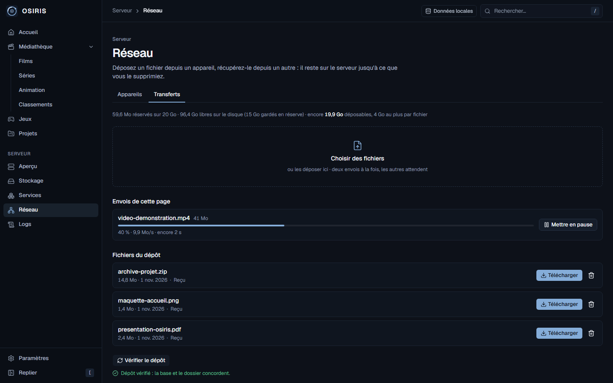

Drop a file from the iPhone, pick it up on the PC: <b>8 MiB chunks</b>, progress, pause and resume, <b>SHA-256</b> check before a file is offered, resumable downloads (<code>Range</code>), quota and disk reserve, deletion only after confirmation. Validated for real: iPhone → server → PC, byte-identical.

### On the iPhone

<table>
<tr>
<td width="33%">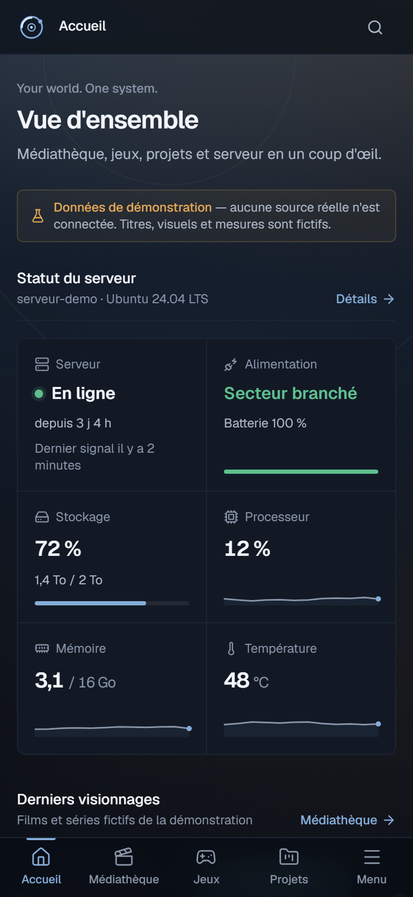</td>
<td width="33%">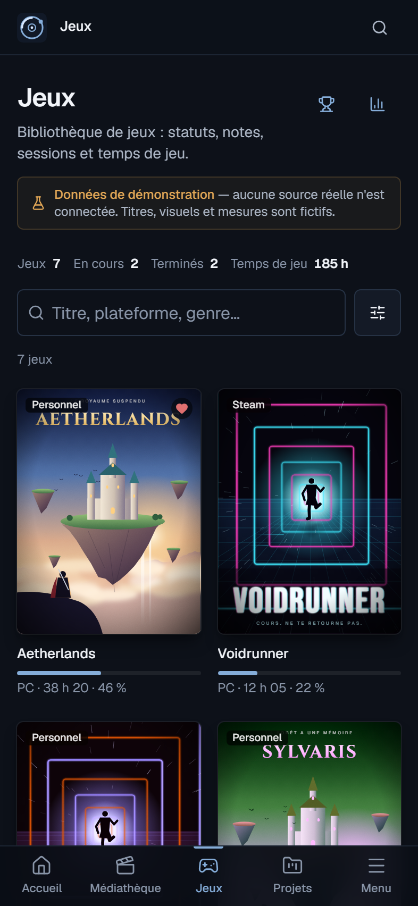</td>
<td width="33%">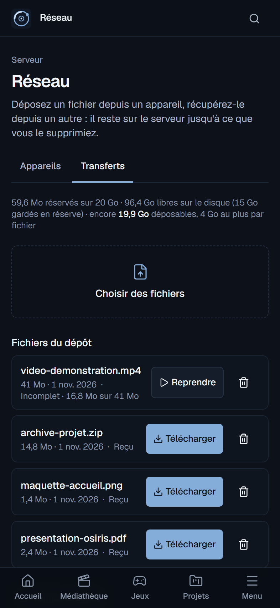</td>
</tr>
</table>

Every page is designed for a 393 px screen: tab bar, safe areas, 44 px touch targets, no horizontal scrolling (checked by automated tests).

**[→ Full gallery (20 screenshots)](docs/gallery.md)**

## Architecture

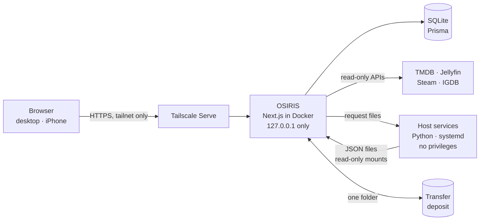

The web application never runs a command and never talks to the local network itself. Monitoring, storage analysis, the Tailscale inventory and Wake-on-LAN are **small separate services**, each running under an unprivileged system user inside a systemd sandbox; they exchange **JSON files** with OSIRIS through narrow mounts. [Full architecture →](docs/architecture.md)

## Technology

| Area | Stack |
|---|---|
| Web application | Next.js (App Router, Server Actions), React, TypeScript (strict) |
| Interface | Tailwind CSS, shadcn/ui (Radix), lucide icons |
| Data | Prisma, SQLite, Zod validation |
| Host services | Python (standard library only), systemd |
| Deployment | Docker Compose, Tailscale Serve, Linux |
| Quality | Vitest, Playwright, ESLint, Prettier, GitHub Actions |
| Integrations | TMDB, Jellyfin, Steam Web API, IGDB |

This is the project's stack, not a list of skills I claim to master; see <a href="#built-with-vibe-coding">how it is built</a>.

## Security and isolation

- 🔒 **Private by design**: listens on `127.0.0.1` only, exposed solely through Tailscale Serve to my own tailnet; no public port.
- 🧱 **Hardened container**: read-only filesystem, all Linux capabilities dropped, non-root user, no Docker socket, no command execution.
- 🧩 **Separate host services** for monitoring, storage, devices and Wake-on-LAN, each sandboxed by systemd; most have **no IP network at all**.
- 📖 **Read-only by default**: Jellyfin, Steam, storage and devices are only read; synchronization never overwrites personal data.
- 🗑️ **No automatic deletion** of user files: anything destructive needs an explicit, confirmed action.
- 🔑 **No secrets in Git**: keys live in a server-only file, excluded from the repository and the Docker build context.
- 💾 **Additive migrations** tried on a copy of the production database, automatic backups before every update and every night.

[Security model in detail →](docs/security.md)

## Tests and quality

| Suite | Tests | What it covers |
|---|---:|---|
| Vitest | **1,316** in 133 files | domain rules, services and actions on temporary databases, connectors against fake servers, migrations, isolation guards |
| Playwright | **150** scenarios in 37 files | real user journeys on desktop (1440 px), tablet (768 px) and mobile |
| Python `unittest` | **88** | host agent, storage scanner, device collector and Wake-on-LAN service on fake data |

Every test runs **without a personal database, real key or external network**: temporary databases, fake TMDB, Jellyfin, Steam and IGDB servers, fictitious devices and files. CI runs on every push and pull request: checks, end-to-end tests, and a Docker image smoke test. [Testing strategy →](docs/testing.md)

Counts as of 1 November 2026.

## Built with vibe coding

OSIRIS is built with **vibe coding**, by choice: AI coding agents do most of the work on the code, the tests and the documentation.

I lead the project. I define the needs, priorities, constraints and user experience, validate the technical choices (recorded in 18 decision records), approve each migration and interface, and run the real-world trials on my own hardware, from the first Wake-on-LAN to the first iPhone → PC transfer.

## Roadmap

- **Next major step: a Windows agent** for the desktop PC: full hardware details, a **clean shutdown** (always confirmed) and **local RGB lighting control** that never leaves the PC.
- **Later:** interface refinements for file transfers, a projects module, episode-level tracking, monitoring alerts, home automation, 3D printer status and robotic arm integration.

[Public roadmap →](docs/roadmap.md)

## Documentation

| Document | Content |
|---|---|
| [Gallery](docs/gallery.md) | All 20 screenshots with captions |
| [Architecture](docs/architecture.md) | Components, data flows, isolation by files and mounts |
| [Security](docs/security.md) | What is protected, and how |
| [Testing](docs/testing.md) | Test levels, isolation, CI |
| [Roadmap](docs/roadmap.md) | Shipped, next, later |

---

OSIRIS is a personal project by <a href="https://github.com/Alexkadere">Alexandre Goulhot-Lassalle</a>. Screenshots show fictitious data only. In the real application, film and series metadata comes from TMDB: OSIRIS uses the TMDB API but is not endorsed or certified by TMDB. Steam is a trademark of Valve Corporation; IGDB is operated by Twitch.
