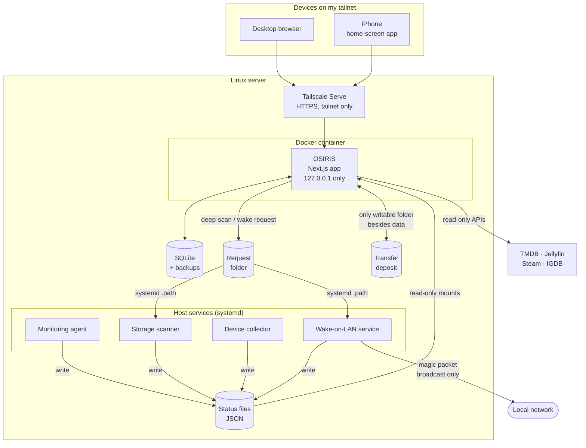

# OSIRIS — Architecture

A high-level view of how OSIRIS is built and deployed, as of November 2026. It describes the real design without private details: no addresses, hostnames, paths of my server or credentials.

[← Back to the README](../README.md)

## Overview

**One rule shapes the design:** the web application holds data and draws the interface, but it **never runs a command, never touches the host system and never speaks to the local network**. Anything that needs the host is done by a small dedicated service, and the two sides only exchange **files** through narrow Docker mounts.

## The web application

| Layer | Role |
|---|---|
| **Presentation** | Next.js App Router pages and reusable components (Tailwind CSS, shadcn/ui). Loading, empty and error states on every page; responsive from 393 px. |
| **Server Actions and route handlers** | Every write goes through a Server Action validated with Zod; a few route handlers serve health checks, live measurements, search, and file transfers. |
| **Domain services** | Business rules per module: media, rankings, games, monitoring, storage, devices, transfers, activity log. Also the in-process schedulers for Jellyfin and Steam synchronization. |
| **Persistence and connectors** | Prisma repositories on SQLite; one connector per external service (TMDB, Jellyfin, Steam, IGDB), each with its own schemas and error handling. |

### Data model principles

- **Metadata and personal data are separate.** A title's metadata (`Work`, `Game`) never shares a table with my rating, favorite, notes or status (`LibraryEntry`, `GameEntry`).
- **External observations are stored apart.** What Jellyfin or Steam reports is kept as observations, then reconciled by explicit rules: a sync may advance a status, but never overwrites a rating, a note, a protected status or a more recent manual choice.
- **Devices are not stored**, only the names and types I choose for them, keyed by Tailscale's stable identifier.
- **Demo mode** uses fictitious data and refuses every write on the server side.

The schema has evolved through **14 additive migrations** (no table rewritten, no data dropped), each with a data-preservation test.

## Host services

Each service is a short Python script (standard library only) run by systemd under a **dedicated unprivileged system user** (the monitoring agent and the storage scanner share one; the collector and the Wake-on-LAN service each have their own), with no capabilities, a read-only view of the system and memory limits.

| Service | What it does | Network | Exchange with OSIRIS |
|---|---|---|---|
| **Monitoring agent** | CPU, memory, temperatures, power, disks and service states; one-second measurements kept in RAM | none (Unix sockets only) | writes snapshot and live JSON files, mounted **read-only** |
| **Storage scanner** | Daily quick analysis (metadata only) and on-demand deep analysis that confirms duplicates by SHA-256; lowest CPU and I/O priority | none | report mounted read-only; a deep scan starts when OSIRIS writes a request file |
| **Device collector** | One `GET` of the local Tailscale status every 30 s; keeps name, system, online state, link type, key expiry | none (local socket only) | device list mounted read-only |
| **Wake-on-LAN service** | Sends the magic packet to the **single** device configured on the server | only the LAN broadcast address is allowed | started by a request file containing an id and a date, never a target; reports its status in a read-only file |

The container sees these files through **read-only mounts**. It can write in exactly four places: its database, its backups, a request folder (deep scan, Wake-on-LAN) and the transfer deposit.

## Feature flows

### Jellyfin and Steam synchronization

1. A scheduler inside OSIRIS calls the service with read-only requests.
2. Results are stored as **observations**, with a journal of every change.
3. Rules decide what may change: a status can move forward on its own; a rating, note, favorite or a manually locked status never changes.
4. Pages left open refresh after a Jellyfin sync, without a reload.

### Wake-on-LAN

1. On the PC's page, **Allumer** opens a confirmation dialog.
2. OSIRIS checks what it can (device configured, not already online, no request in the last minute), then writes `wake.request`.
3. systemd notices the file and starts the Wake-on-LAN service once; it refuses old, repeated or too-frequent requests, then sends the packet.
4. OSIRIS shows "signal sent", then "**Tailscale connection detected**" when the collector sees the PC again. A connection is not proof that Windows is ready, and the text says so.

### File transfers

1. The browser announces the file; the server **reserves its full size** under a lock, against the quota and a minimum free-disk reserve.
2. The file is sent in **8 MiB chunks**, each accepted only at the expected position and written to disk before the reply; two uploads run at a time.
3. Pause keeps the data; resume is accepted only with the same file (name, size and modification date checked on both sides).
4. When complete, the server computes the **SHA-256**, renames the file atomically and only then offers it.
5. Downloads are always attachments (`nosniff`, sandboxed), with `Range` support for resuming.
6. Files are stored under random identifiers: no name chosen in the browser reaches the filesystem.

## Deployment

- **Docker Compose** on a Linux server; the image runs as a non-root user with a read-only root filesystem and a health check.
- **Tailscale Serve** publishes HTTPS to the tailnet only; nothing is open to the internet.
- Updates are manual and scripted: build, stop, **backup**, migrate, restart, wait for the health check. Backups also run every night.
- The iPhone uses OSIRIS as a home-screen web app, with iOS safe areas handled.

## Stack (major versions, November 2026)

Next.js 16 · React 19 · TypeScript 5 (strict) · Tailwind CSS 4 · Prisma 7 · SQLite · Zod 4 · Vitest · Playwright · Python 3 · Node.js 24 · Docker Compose · systemd · Tailscale.

## Integrations

| Service | Use | Mode |
|---|---|---|
| TMDB | search and metadata for films and series | read-only; images go through the application's image optimizer |
| Jellyfin | availability, playback progress, recently watched | read-only, scheduled |
| Steam Web API | owned games, playtime, last played, achievements | read-only, scheduled |
| IGDB | game search and metadata | read-only |
| Tailscale | device inventory | read-only, through the collector only |
