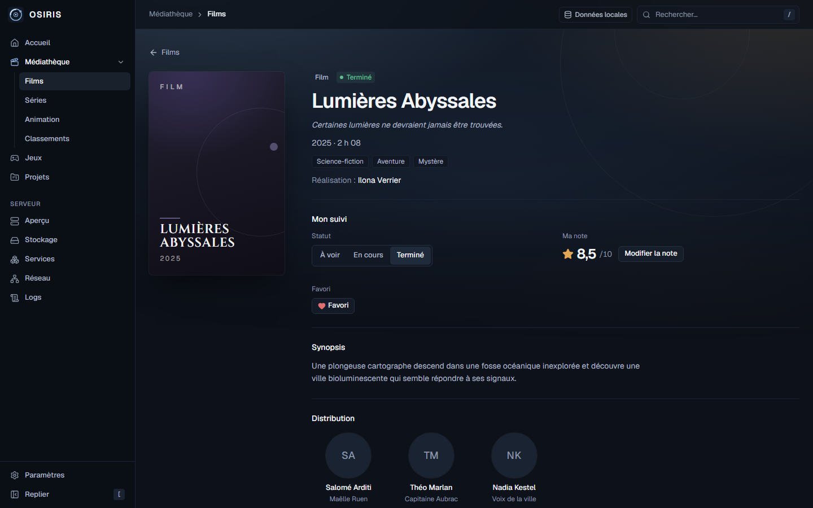
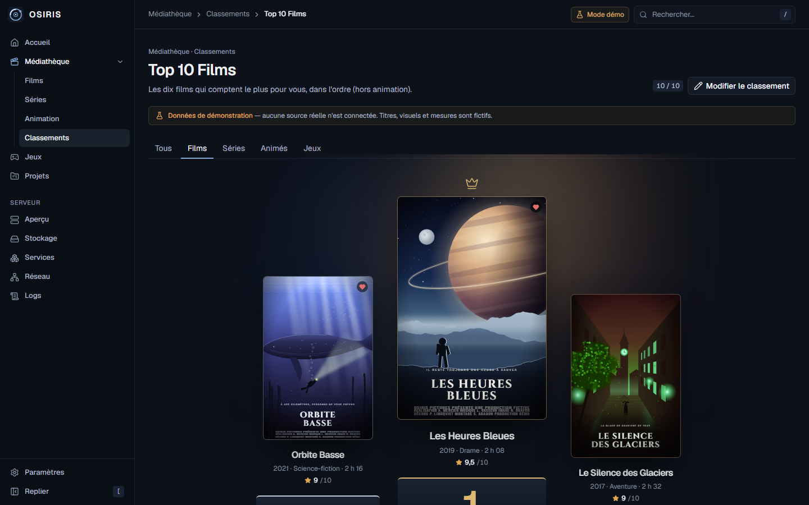
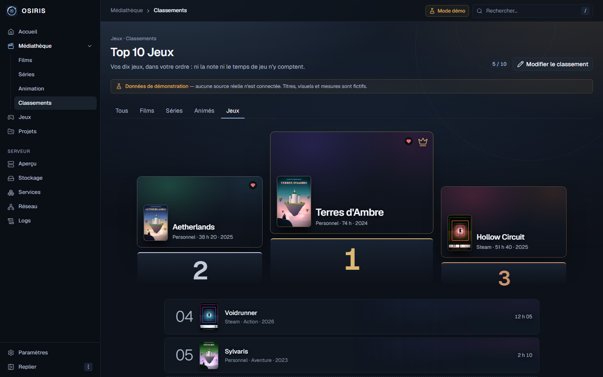
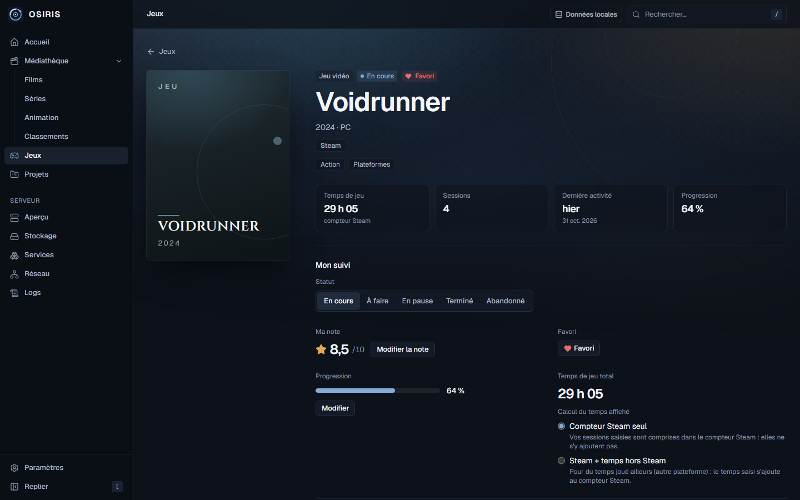
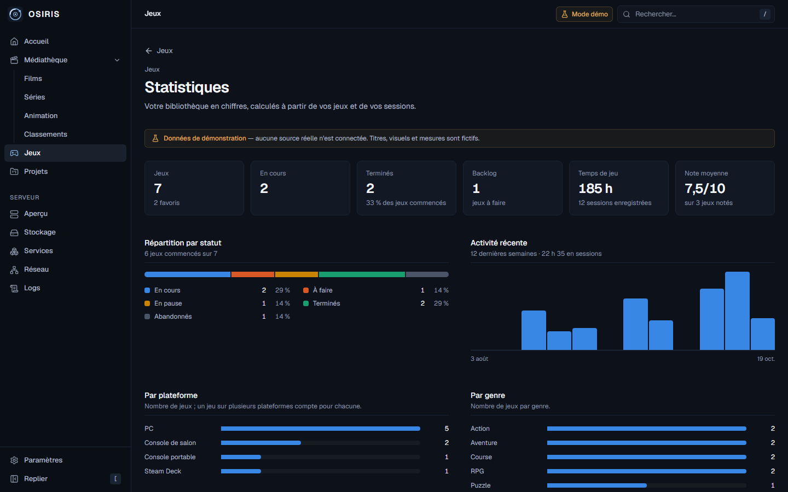
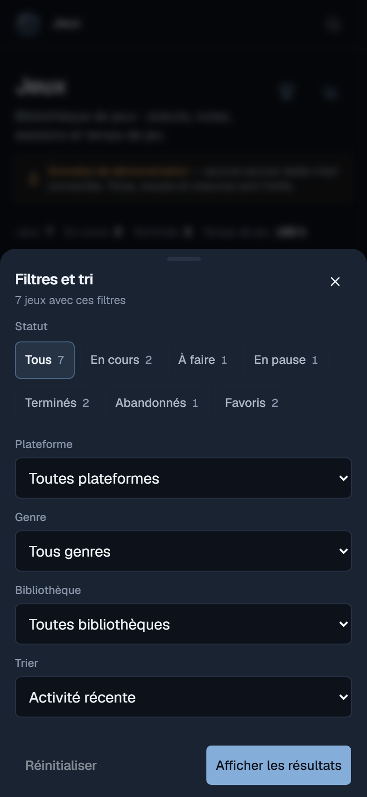
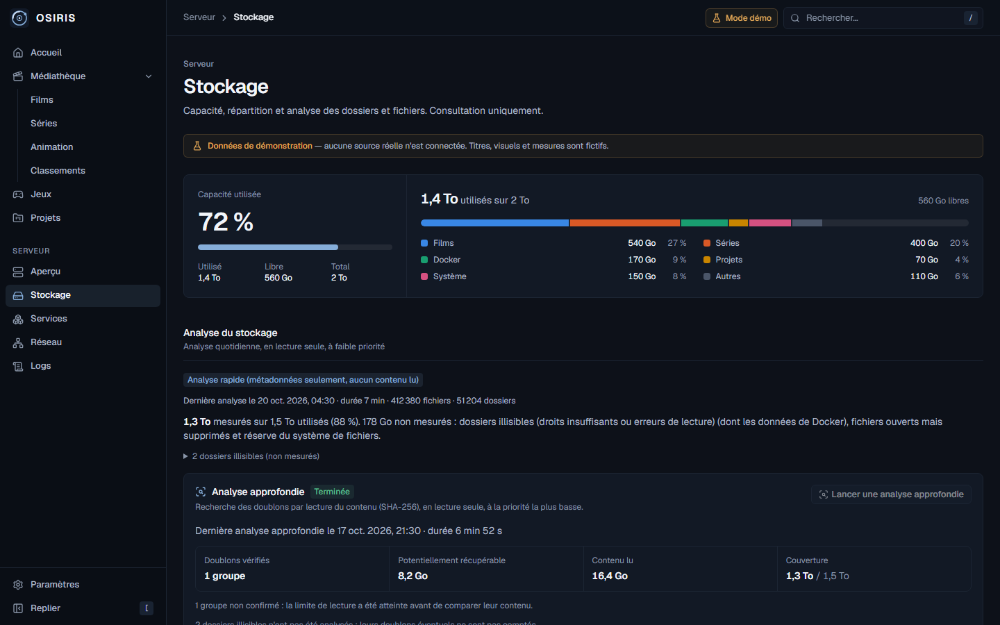
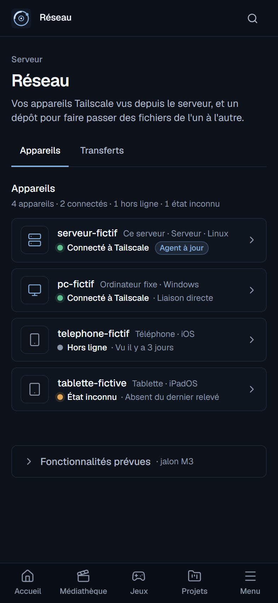
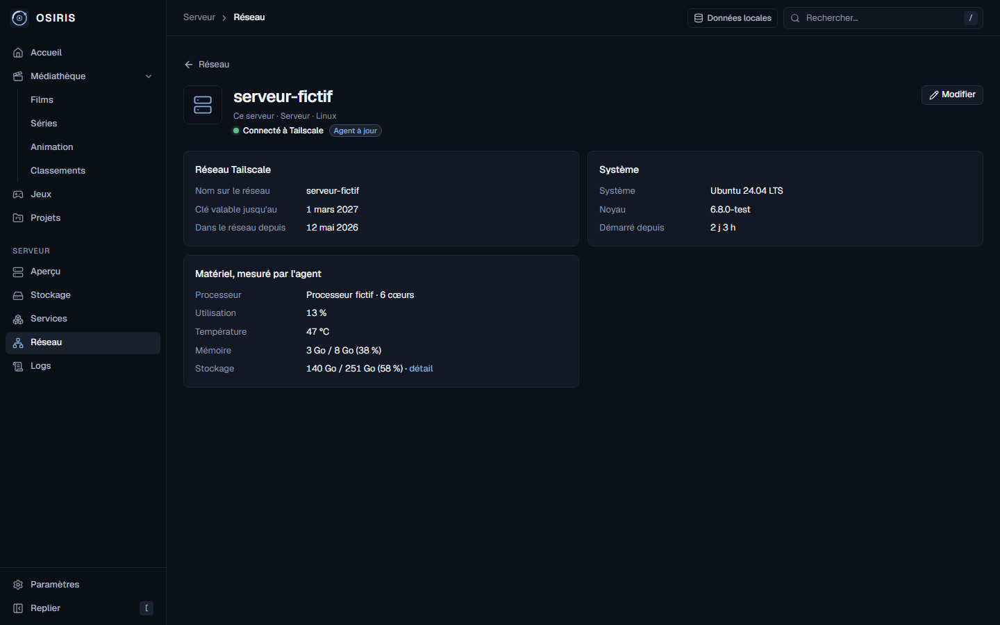
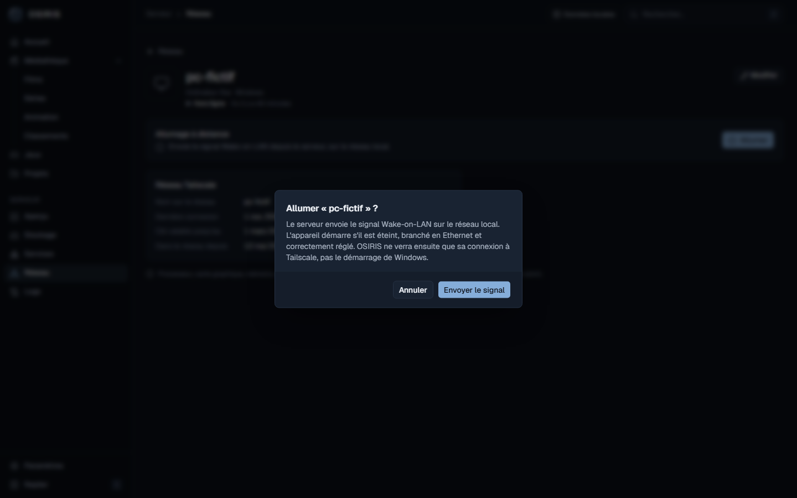

# OSIRIS — Gallery

Every screenshot was taken on **1 November 2026** from the real application, running locally and isolated from production:

- **demo mode** (marked "Données de démonstration" in the interface), or
- a **local instance with a temporary database** and **fictitious** titles, games, devices and files.

No screenshot comes from the production server or contains a real address, device name, library title or personal file. The interface is in French; desktop shots are 1440 × 900, iPhone shots 393 × 852 (rendered at 2×).

[← Back to the README](../README.md)

## Contents

[Home](#home) · [Media library](#media-library) · [Rankings](#rankings) · [Games](#games) · [Server](#server) · [Devices](#devices) · [Wake-on-LAN](#wake-on-lan) · [Transfers](#transfers)

## Home

**01 · Home.** Server health at a glance (power, storage, CPU, memory, temperature), recently watched titles and active projects. *Demo mode.*

**02 · Home on iPhone.** Same information in a single column, with the bottom tab bar. *Demo mode.*

## Media library

**03 · Films library.** Poster grid with status, favorite, Jellyfin availability and remaining time; search, filters, sorting and server-side pagination. *Demo mode, generated artwork.*

**04 · Film detail.** Status, half-point rating, favorite, synopsis, director and cast; below, personal notes and editable information. *Isolated instance, fictitious film and people.*

## Rankings

**05 · Top 10 Films.** A podium followed by places 4 to 10; reordered with the mouse, keyboard or touch, and saved only when confirmed. Films, series and animation rankings are mutually exclusive. *Demo mode.*

**09 · Top 10 Games.** Chosen by hand: neither rating nor playtime decides the order. *Demo mode.*

## Games

**06 · Games library.** Steam and personal games labelled by origin, with progress, playtime and rating; search, "Filtres et tri" and counters. *Demo mode.*

**07 · Game detail.** Steam playtime counter, sessions, last activity, progress, rating and favorite; further down, the review, the session log and Steam achievements (3 of 5 unlocked). *Isolated instance, fictitious game linked to a fictitious Steam entry; no request to Steam.*

**08 · Statistics.** Status breakdown, recent activity by week, platforms and genres, all computed from the library and sessions. *Demo mode.*

<table>
<tr>
<td width="50%"></td>
<td width="50%"></td>
</tr>
</table>

**10–11 · Games on iPhone.** One-line command bar (search, filters, add) and a bottom sheet whose choices apply immediately. *Demo mode.*

## Server

**12 · Server overview.** Live measurements from the host agent, CPU and memory history, and service status. *Demo mode: the host, services and values are fictitious.*

**13 · Storage analysis.** Space by category, daily quick analysis (metadata only) and an on-demand deep analysis that confirms duplicates by SHA-256. Read-only: no delete, move or clean-up action exists. *Demo mode.*

## Devices

**14 · Device inventory.** Devices of the tailnet as seen by the server, with four distinct states: *Connected to Tailscale*, *Offline · seen 3 days ago*, *Unknown · missing from the last reading*, and *Agent up to date* for the server itself. *Isolated instance, fictitious devices without any address.*

<table>
<tr>
<td width="50%"></td>
<td width="50%">

**15 · Devices on iPhone.** Compact rows with large touch targets; the list refreshes itself every 30 seconds while visible.

</td>
</tr>
</table>

**16 · Device page.** Only the sections that have data: Tailscale network, system, and hardware measured by the host agent. *Isolated instance, fictitious server.*

## Wake-on-LAN

**17 · Confirmation.** Nothing is sent without this dialog, which explains exactly what OSIRIS will and will not be able to see. *Isolated instance: the "signal" only writes a request file in a temporary folder; no packet is sent.*

**18 · Result.** After the server's service reports the signal as sent, OSIRIS waits for the PC to reappear on Tailscale and says so, without claiming that Windows has finished booting. *Isolated instance; the real feature was validated from a full shutdown.*

## Transfers

**19 · Transfers.** Quota and disk reserve on one line, drop zone, an upload in progress (speed, time left, pause), verified files ready to download or delete, and a deposit check. *Isolated instance: fictitious disk values, files of random bytes with neutral names.*

**20 · Transfers on iPhone.** A paused upload can be resumed only with the same file (name, size and date checked by the browser and the server). *Isolated instance.*
